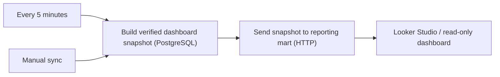

# Financial Dashboard Reporting Sync · n8n case study

**Status:** Active on 22 October 2026. **Production workflow size:** 7 nodes.

## Problem

A financial assistant writes verified records to its canonical PostgreSQL database. A dashboard needs consistent, read-optimized reporting data, but must not become a second source of truth.

## Design

The live workflow uses a schedule trigger, a manual trigger, PostgreSQL query stage and HTTP synchronization stage. It mirrors verified reporting data to a separate dashboard mart.

## Design considerations

- Canonical ledger remains in PostgreSQL, separate from the reporting read model.
- Sync every five minutes, plus a manual trigger for verification and repair.
- Distinguish transactions by currency rather than silently converting NGN and USD.
- Validate access control, destination authentication and repeat delivery behavior before connecting a real reporting endpoint.

## Public artifacts

- [Sanitized 7-node reporting workflow reference](templates/financial-dashboard-sync.redacted.json): importable n8n graph with **credential links, SQL, endpoint and request body replaced**. It is a configuration-required reference, not a working production integration.
- [Runnable Finance Snapshot Demo](templates/finance-snapshot-demo.json): uses dummy records only, no network calls or credentials.

## Stack

n8n · PostgreSQL · HTTP API · Railway reporting mart · Looker Studio.
