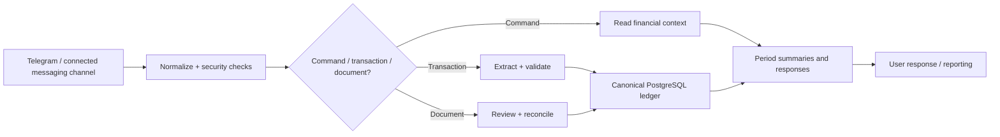

# Financial Intelligence Agent · n8n case study

**Status:** Active in the connected n8n workspace on 22 October 2026. **Production workflow size:** 264 nodes.

## Problem

Financial activity arrives as messy user messages, receipts and follow-up commands. An assistant must transform them into consistent records while preserving personal/business separation, auditability, approval steps, and context.

## Architecture

## Engineering highlights

- Fast-path classification and structured transaction extraction, with validation before recording.
- PostgreSQL-backed profile, record, savings, obligation, receivable and payable functions.
- Financial review and reconciliation paths, including document-oriented processing.
- Period commands, personal/business context switching, alerts and generated reporting.
- Shared financial logic designed for additional messaging surfaces rather than duplicating the ledger per channel.

## Technology

n8n · PostgreSQL · Telegram · LLMs / OpenAI nodes · scheduled workflows · webhook and workflow execution boundaries.

## Publication note

This is **not** a full production workflow export. The original graph has many connected credential-bearing and code-bearing nodes, including account-specific integrations. Publishing that implementation verbatim would expose details that belong in the private runtime.

For an **importable, credential-free illustration**, see [Finance Snapshot Demo](templates/finance-snapshot-demo.json). It demonstrates a small deterministic part of the reporting logic, not the 264-node production system.
