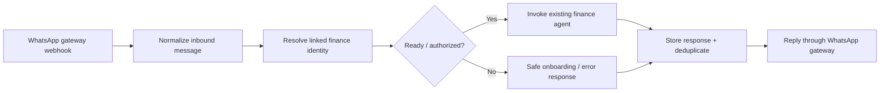

# WhatsApp-to-Finance Bridge · n8n case study

**Status:** Connector workflow currently **inactive** in the connected n8n workspace, as checked on 22 October 2026. **Workflow size:** 17 nodes.

## Objective

Let WhatsApp conversations use the *same financial intelligence and canonical records* as the existing Telegram assistant, instead of splitting data and application logic across messaging channels.

## Architecture

## Engineering concerns

- Identity resolution across messaging platforms and persistent account linkage.
- Inbound normalization and safe handling of unexpected message types.
- Separation of transport delivery from the shared finance engine.
- Error handling, response storage, routing checks and deduplication.
- Test paths that do not send real messages to customers.

## Technology

n8n · WhatsApp transport / Node.js gateway · PostgreSQL · reusable subworkflow execution · webhooks and HTTP.

## Scope and disclosure

This is a **sanitized architecture case study**, not an export of working webhook handlers, database SQL, secret-bearing routes, or client identifiers. The workflow is currently inactive in the connected n8n instance, so this page does not advertise it as a verified live customer messaging channel.
